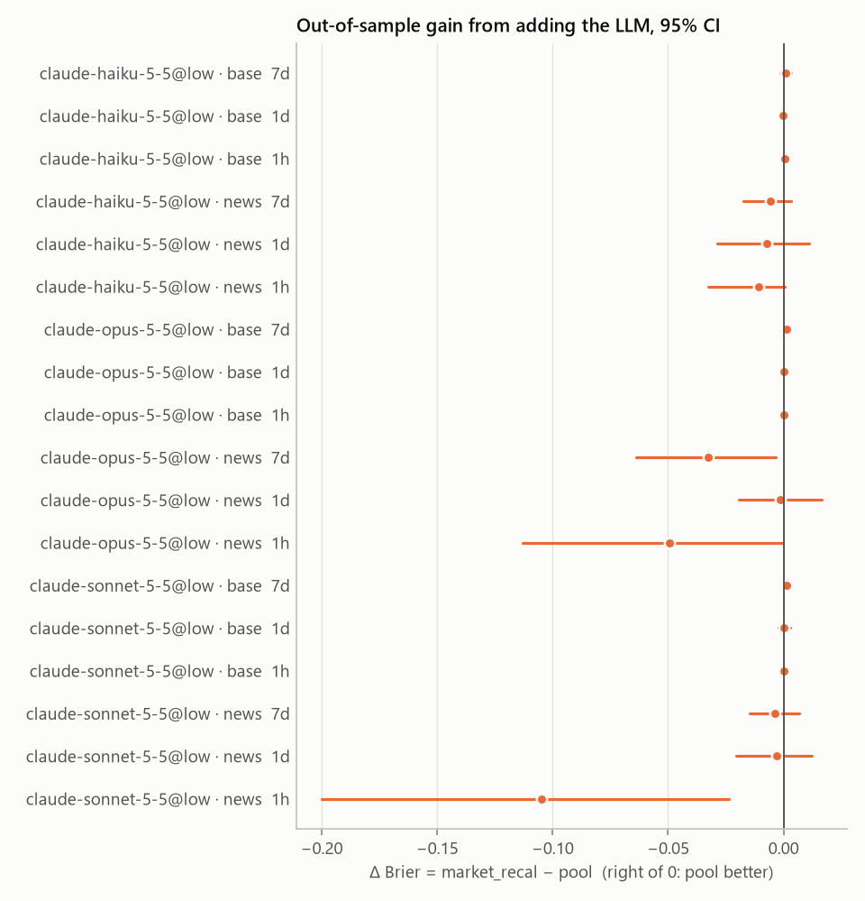
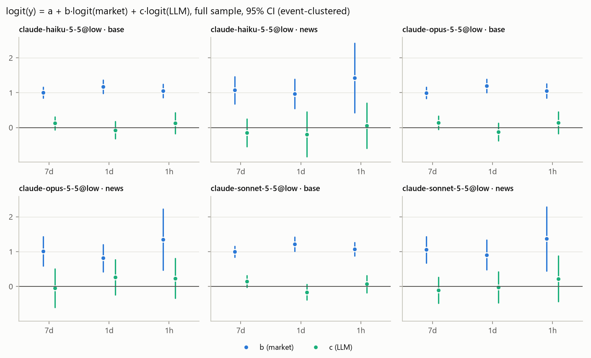
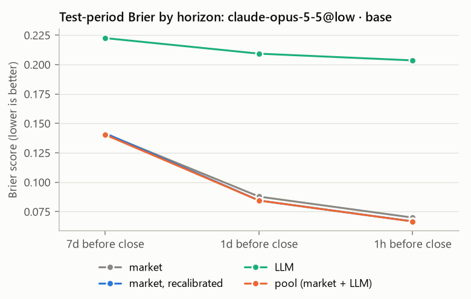
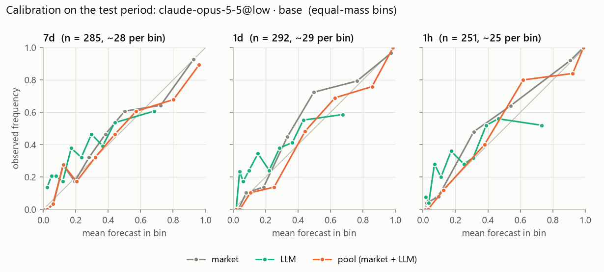
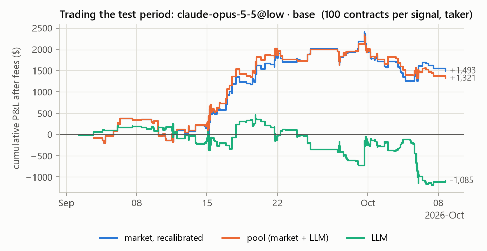

# pricedin report: study v1

Generated by pricedin 0.1.0 from `evaluation.json`. The analysis plan is in `docs/preregistration.md`. The model forecasts without web research, so results are a lower bound on what an LLM adds to the market price, not a test of a research agent. Figures for a single forecaster show **claude-opus-5-5@low · base**, the lowest LLM Brier.

## Sample

13125 eligible candidates in 6006 events. 6006 remain after the per-event cap (1). 712 are sampled after the per-cell cap (100).

Questions by category and venue:

| category | polymarket | total |
| --- | ---: | ---: |
| crypto | 36 | 36 |
| culture | 100 | 100 |
| economics | 62 | 62 |
| finance | 75 | 75 |
| other | 8 | 8 |
| politics | 100 | 100 |
| sports | 100 | 100 |
| tech | 100 | 100 |
| weather | 31 | 31 |
| world | 100 | 100 |
| **total** | 712 | **712** |

214 questions (30.1%) closed early.

Rows per horizon. A row needs a snapshot and a parsed forecast.

| horizon | snapshots | missing | rows: claude-haiku-5-5@low · base | rows: claude-haiku-5-5@low · news | rows: claude-opus-5-5@low · base | rows: claude-opus-5-5@low · news | rows: claude-sonnet-5-5@low · base | rows: claude-sonnet-5-5@low · news |
| --- | ---: | ---: | ---: | ---: | ---: | ---: | ---: | ---: |
| 7d | 639 | 73 | 639 | 98 | 639 | 98 | 639 | 98 |
| 1d | 598 | 114 | 598 | 77 | 598 | 77 | 598 | 77 |
| 1h | 506 | 206 | 506 | 77 | 506 | 77 | 506 | 77 |

Rows dropped while building each panel (question × horizon):

- claude-haiku-5-5@low · base: 393 missing snapshot.
- claude-haiku-5-5@low · news: 1491 missing forecast, 393 missing snapshot.
- claude-opus-5-5@low · base: 393 missing snapshot.
- claude-opus-5-5@low · news: 1491 missing forecast, 393 missing snapshot.
- claude-sonnet-5-5@low · base: 393 missing snapshot.
- claude-sonnet-5-5@low · news: 1491 missing forecast, 393 missing snapshot.

Missing snapshots by reason: 393 × market closed before the snapshot time.

Split at **2026-09-01T23:26:00Z**. Training rows closed before it. Test rows were snapshotted at or after it. Rows that straddle it are embargoed.

| forecaster | h | train | test | embargoed |
| --- | --- | ---: | ---: | ---: |
| claude-haiku-5-5@low · base | 7d | 319 | 285 | 35 |
| claude-haiku-5-5@low · base | 1d | 294 | 292 | 12 |
| claude-haiku-5-5@low · base | 1h | 243 | 251 | 12 |
| claude-haiku-5-5@low · news | 7d | 42 | 44 | 12 |
| claude-haiku-5-5@low · news | 1d | 35 | 36 | 6 |
| claude-haiku-5-5@low · news | 1h | 31 | 41 | 5 |
| claude-opus-5-5@low · base | 7d | 319 | 285 | 35 |
| claude-opus-5-5@low · base | 1d | 294 | 292 | 12 |
| claude-opus-5-5@low · base | 1h | 243 | 251 | 12 |
| claude-opus-5-5@low · news | 7d | 42 | 44 | 12 |
| claude-opus-5-5@low · news | 1d | 35 | 36 | 6 |
| claude-opus-5-5@low · news | 1h | 31 | 41 | 5 |
| claude-sonnet-5-5@low · base | 7d | 319 | 285 | 35 |
| claude-sonnet-5-5@low · base | 1d | 294 | 292 | 12 |
| claude-sonnet-5-5@low · base | 1h | 243 | 251 | 12 |
| claude-sonnet-5-5@low · news | 7d | 42 | 44 | 12 |
| claude-sonnet-5-5@low · news | 1d | 35 | 36 | 6 |
| claude-sonnet-5-5@low · news | 1h | 31 | 41 | 5 |

## Primary hypotheses

Test-period Brier scores (lower is better). Δ = Brier(market_recal) − Brier(pool), positive when adding the LLM helps; 95% CI from an event-clustered bootstrap. c is the LLM coefficient in logit(y) = a + b·logit(market) + c·logit(LLM), fitted on the full sample with event-clustered (CR1) errors. Holm adjustment is over all 36 tests as one family (H1 and H2 × forecaster × horizon). H2 p is one-sided (Δ > 0); H1 p is two-sided (c ≠ 0).

| forecaster | h | n test | market | mkt recal | LLM | pool | Δ [95% CI] | H2 p (Holm) | c (z) | H1 p (Holm) |
| --- | --- | ---: | ---: | ---: | ---: | ---: | ---: | ---: | ---: | ---: |
| claude-haiku-5-5@low · base | 7d | 285 | 0.1413 | 0.1416 | 0.2349 | 0.1407 | +0.0009 [-0.0013, +0.0031] | 1.000 | +0.12 (z +1.3) | 1.000 |
| claude-haiku-5-5@low · base | 1d | 292 | 0.0878 | 0.0845 | 0.2152 | 0.0848 | -0.0003 [-0.0012, +0.0005] | 1.000 | -0.07 (z -0.6) | 1.000 |
| claude-haiku-5-5@low · base | 1h | 251 | 0.0700 | 0.0668 | 0.2119 | 0.0663 | +0.0005 [-0.0010, +0.0020] | 1.000 | +0.13 (z +0.8) | 1.000 |
| claude-haiku-5-5@low · news | 7d | 44 | 0.1610 | 0.1641 | 0.2543 | 0.1700 | -0.0058 [-0.0173, +0.0034] | 1.000 | -0.15 (z -0.8) | 1.000 |
| claude-haiku-5-5@low · news | 1d | 36 | 0.0939 | 0.1046 | 0.1985 | 0.1117 | -0.0071 [-0.0288, +0.0110] | 1.000 | -0.19 (z -0.6) | 1.000 |
| claude-haiku-5-5@low · news | 1h | 41 | 0.0558 | 0.0626 | 0.2269 | 0.0733 | -0.0107 [-0.0328, +0.0007] | 1.000 | +0.05 (z +0.2) | 1.000 |
| claude-opus-5-5@low · base | 7d | 285 | 0.1413 | 0.1416 | 0.2225 | 0.1404 | +0.0012 [-0.0006, +0.0031] | 1.000 | +0.14 (z +1.5) | 1.000 |
| claude-opus-5-5@low · base | 1d | 292 | 0.0878 | 0.0845 | 0.2093 | 0.0845 | +0.0000 [-0.0008, +0.0009] | 1.000 | -0.12 (z -0.9) | 1.000 |
| claude-opus-5-5@low · base | 1h | 251 | 0.0700 | 0.0668 | 0.2036 | 0.0667 | +0.0001 [-0.0018, +0.0018] | 1.000 | +0.14 (z +0.9) | 1.000 |
| claude-opus-5-5@low · news | 7d | 44 | 0.1610 | 0.1641 | 0.2414 | 0.1969 | -0.0328 [-0.0640, -0.0035] | 1.000 | -0.04 (z -0.2) | 1.000 |
| claude-opus-5-5@low · news | 1d | 36 | 0.0939 | 0.1046 | 0.2070 | 0.1060 | -0.0014 [-0.0195, +0.0165] | 1.000 | +0.26 (z +1.0) | 1.000 |
| claude-opus-5-5@low · news | 1h | 41 | 0.0558 | 0.0626 | 0.2115 | 0.1119 | -0.0493 [-0.1131, -0.0000] | 1.000 | +0.24 (z +0.8) | 1.000 |
| claude-sonnet-5-5@low · base | 7d | 285 | 0.1413 | 0.1416 | 0.2203 | 0.1403 | +0.0013 [-0.0000, +0.0027] | 0.936 | +0.14 (z +1.7) | 1.000 |
| claude-sonnet-5-5@low · base | 1d | 292 | 0.0878 | 0.0845 | 0.2116 | 0.0842 | +0.0003 [-0.0023, +0.0030] | 1.000 | -0.16 (z -1.5) | 1.000 |
| claude-sonnet-5-5@low · base | 1h | 251 | 0.0700 | 0.0668 | 0.2084 | 0.0664 | +0.0003 [-0.0010, +0.0016] | 1.000 | +0.07 (z +0.6) | 1.000 |
| claude-sonnet-5-5@low · news | 7d | 44 | 0.1610 | 0.1641 | 0.2565 | 0.1679 | -0.0038 [-0.0148, +0.0069] | 1.000 | -0.11 (z -0.6) | 1.000 |
| claude-sonnet-5-5@low · news | 1d | 36 | 0.0939 | 0.1046 | 0.1848 | 0.1075 | -0.0029 [-0.0204, +0.0122] | 1.000 | -0.02 (z -0.1) | 1.000 |
| claude-sonnet-5-5@low · news | 1h | 41 | 0.0558 | 0.0626 | 0.2093 | 0.1674 | -0.1048 [-0.2001, -0.0238] | 1.000 | +0.22 (z +0.7) | 1.000 |

\* rejects at α = 0.05 after Holm adjustment.

- claude-haiku-5-5@low · base: Δ +0.0002 [-0.0013, +0.0016] on 828 test rows (all horizons pooled; not part of the family).
- claude-haiku-5-5@low · news: Δ -0.0044 [-0.0131, +0.0035] on 121 test rows (all horizons pooled; not part of the family).
- claude-opus-5-5@low · base: Δ +0.0003 [-0.0005, +0.0012] on 828 test rows (all horizons pooled; not part of the family).
- claude-opus-5-5@low · news: Δ -0.0173 [-0.0379, +0.0012] on 121 test rows (all horizons pooled; not part of the family).
- claude-sonnet-5-5@low · base: Δ +0.0002 [-0.0001, +0.0004] on 828 test rows (all horizons pooled; not part of the family).
- claude-sonnet-5-5@low · news: Δ -0.0048 [-0.0174, +0.0069] on 121 test rows (all horizons pooled; not part of the family).

## Calibration

Expected calibration error (ECE, equal-mass bins) and the Murphy decomposition Brier ≈ REL − RES + UNC on the test period. Lower REL is better calibrated; higher RES separates outcomes better.

| forecaster | h | ECE market | ECE LLM | ECE pool | REL/RES market | REL/RES LLM | REL/RES pool | UNC |
| --- | --- | ---: | ---: | ---: | ---: | ---: | ---: | ---: |
| claude-haiku-5-5@low · base | 7d | 0.0551 | 0.1450 | 0.0493 | 0.0052 / 0.0879 | 0.0267 / 0.0181 | 0.0048 / 0.0854 | 0.2245 |
| claude-haiku-5-5@low · base | 1d | 0.0516 | 0.1085 | 0.0297 | 0.0069 / 0.1308 | 0.0150 / 0.0228 | 0.0016 / 0.1296 | 0.2158 |
| claude-haiku-5-5@low · base | 1h | 0.0361 | 0.1057 | 0.0315 | 0.0039 / 0.1494 | 0.0156 / 0.0241 | 0.0017 / 0.1494 | 0.2157 |
| claude-haiku-5-5@low · news | 7d | 0.1175 | 0.1825 | 0.1378 | 0.0320 / 0.0919 | 0.0473 / 0.0124 | 0.0343 / 0.0863 | 0.2169 |
| claude-haiku-5-5@low · news | 1d | 0.1512 | 0.2033 | 0.1557 | 0.0366 / 0.1150 | 0.0717 / 0.0478 | 0.0360 / 0.0965 | 0.1728 |
| claude-haiku-5-5@low · news | 1h | 0.0392 | 0.2437 | 0.0818 | 0.0036 / 0.1234 | 0.0869 / 0.0381 | 0.0172 / 0.1112 | 0.1844 |
| claude-opus-5-5@low · base | 7d | 0.0551 | 0.1116 | 0.0493 | 0.0052 / 0.0879 | 0.0152 / 0.0234 | 0.0047 / 0.0862 | 0.2245 |
| claude-opus-5-5@low · base | 1d | 0.0516 | 0.1026 | 0.0410 | 0.0069 / 0.1308 | 0.0141 / 0.0283 | 0.0030 / 0.1305 | 0.2158 |
| claude-opus-5-5@low · base | 1h | 0.0361 | 0.1024 | 0.0386 | 0.0039 / 0.1494 | 0.0162 / 0.0295 | 0.0042 / 0.1519 | 0.2157 |
| claude-opus-5-5@low · news | 7d | 0.1175 | 0.1852 | 0.1658 | 0.0320 / 0.0919 | 0.0484 / 0.0272 | 0.0647 / 0.0885 | 0.2169 |
| claude-opus-5-5@low · news | 1d | 0.1512 | 0.1703 | 0.1440 | 0.0366 / 0.1150 | 0.0648 / 0.0340 | 0.0306 / 0.0965 | 0.1728 |
| claude-opus-5-5@low · news | 1h | 0.0392 | 0.1720 | 0.1213 | 0.0036 / 0.1234 | 0.0563 / 0.0259 | 0.0391 / 0.1234 | 0.1844 |
| claude-sonnet-5-5@low · base | 7d | 0.0551 | 0.1416 | 0.0502 | 0.0052 / 0.0879 | 0.0241 / 0.0283 | 0.0045 / 0.0892 | 0.2245 |
| claude-sonnet-5-5@low · base | 1d | 0.0516 | 0.1305 | 0.0416 | 0.0069 / 0.1308 | 0.0210 / 0.0305 | 0.0034 / 0.1294 | 0.2158 |
| claude-sonnet-5-5@low · base | 1h | 0.0361 | 0.1102 | 0.0243 | 0.0039 / 0.1494 | 0.0163 / 0.0266 | 0.0014 / 0.1532 | 0.2157 |
| claude-sonnet-5-5@low · news | 7d | 0.1175 | 0.1857 | 0.1379 | 0.0320 / 0.0919 | 0.0628 / 0.0329 | 0.0368 / 0.0863 | 0.2169 |
| claude-sonnet-5-5@low · news | 1d | 0.1512 | 0.1356 | 0.1558 | 0.0366 / 0.1150 | 0.0306 / 0.0340 | 0.0364 / 0.0965 | 0.1728 |
| claude-sonnet-5-5@low · news | 1h | 0.0392 | 0.1668 | 0.1217 | 0.0036 / 0.1234 | 0.0370 / 0.0259 | 0.0281 / 0.0747 | 0.1844 |

## Secondary analyses

### Other contrasts and ablations

Test period. Δ columns are positive when the pool is better. The last three columns are Brier scores of the LLM-only variants and the equal-weight logit average.

| forecaster | h | Δ Brier vs raw market | Δ log score vs mkt recal | LLM recal | LLM extremized | average |
| --- | --- | ---: | ---: | ---: | ---: | ---: |
| claude-haiku-5-5@low · base | 7d | +0.0006 [-0.0044, +0.0057] | +0.0021 [-0.0038, +0.0081] | 0.2194 | 0.2156 | 0.1609 |
| claude-haiku-5-5@low · base | 1d | +0.0030 [-0.0036, +0.0093] | -0.0011 [-0.0032, +0.0010] | 0.2061 | 0.2024 | 0.1183 |
| claude-haiku-5-5@low · base | 1h | +0.0037 [-0.0011, +0.0084] | +0.0002 [-0.0045, +0.0050] | 0.2037 | 0.2008 | 0.0888 |
| claude-haiku-5-5@low · news | 7d | -0.0090 [-0.0318, +0.0115] | -0.0259 [-0.0616, +0.0024] | 0.2414 | 0.2321 | 0.1843 |
| claude-haiku-5-5@low · news | 1d | -0.0178 [-0.0421, +0.0033] | -0.0538 [-0.1537, +0.0157] | 0.2102 | 0.1919 | 0.1144 |
| claude-haiku-5-5@low · news | 1h | -0.0175 [-0.0741, +0.0213] | -0.0807 [-0.2460, +0.0051] | 0.2157 | 0.2146 | 0.0831 |
| claude-opus-5-5@low · base | 7d | +0.0010 [-0.0039, +0.0058] | +0.0034 [-0.0017, +0.0083] | 0.2097 | 0.2085 | 0.1565 |
| claude-opus-5-5@low · base | 1d | +0.0033 [-0.0032, +0.0103] | +0.0005 [-0.0016, +0.0028] | 0.1987 | 0.1973 | 0.1161 |
| claude-opus-5-5@low · base | 1h | +0.0033 [-0.0012, +0.0082] | -0.0005 [-0.0056, +0.0048] | 0.1979 | 0.1966 | 0.0882 |
| claude-opus-5-5@low · news | 7d | -0.0359 [-0.0706, -0.0040] | -0.1527 [-0.2989, -0.0261] | 0.2478 | 0.2302 | 0.1889 |
| claude-opus-5-5@low · news | 1d | -0.0121 [-0.0297, +0.0033] | -0.0238 [-0.0770, +0.0258] | 0.2004 | 0.1928 | 0.1131 |
| claude-opus-5-5@low · news | 1h | -0.0561 [-0.1273, +0.0034] | -0.2268 [-0.5146, -0.0028] | 0.1970 | 0.1999 | 0.0818 |
| claude-sonnet-5-5@low · base | 7d | +0.0010 [-0.0039, +0.0062] | +0.0034 [-0.0003, +0.0072] | 0.2048 | 0.2042 | 0.1546 |
| claude-sonnet-5-5@low · base | 1d | +0.0036 [-0.0046, +0.0112] | +0.0013 [-0.0050, +0.0076] | 0.1977 | 0.1972 | 0.1196 |
| claude-sonnet-5-5@low · base | 1h | +0.0035 [-0.0008, +0.0081] | -0.0003 [-0.0036, +0.0029] | 0.1984 | 0.1976 | 0.0915 |
| claude-sonnet-5-5@low · news | 7d | -0.0069 [-0.0296, +0.0168] | -0.0195 [-0.0524, +0.0123] | 0.2458 | 0.2343 | 0.1844 |
| claude-sonnet-5-5@low · news | 1d | -0.0136 [-0.0363, +0.0060] | -0.0251 [-0.0859, +0.0254] | 0.1862 | 0.1764 | 0.1160 |
| claude-sonnet-5-5@low · news | 1h | -0.1116 [-0.2161, -0.0217] | -0.5221 [-0.9978, -0.1130] | 0.1996 | 0.2020 | 0.0860 |

### News vs base

Test-period Brier of the LLM alone and Δ of the pool, per condition. The two conditions can cover slightly different rows; no paired CI.

| forecaster | h | LLM base | LLM news | Δ pool base | Δ pool news |
| --- | --- | ---: | ---: | ---: | ---: |
| claude-haiku-5-5@low | 7d | 0.2349 | 0.2543 | +0.0009 | -0.0058 |
| claude-haiku-5-5@low | 1d | 0.2152 | 0.1985 | -0.0003 | -0.0071 |
| claude-haiku-5-5@low | 1h | 0.2119 | 0.2269 | +0.0005 | -0.0107 |
| claude-opus-5-5@low | 7d | 0.2225 | 0.2414 | +0.0012 | -0.0328 |
| claude-opus-5-5@low | 1d | 0.2093 | 0.2070 | +0.0000 | -0.0014 |
| claude-opus-5-5@low | 1h | 0.2036 | 0.2115 | +0.0001 | -0.0493 |
| claude-sonnet-5-5@low | 7d | 0.2203 | 0.2565 | +0.0013 | -0.0038 |
| claude-sonnet-5-5@low | 1d | 0.2116 | 0.1848 | +0.0003 | -0.0029 |
| claude-sonnet-5-5@low | 1h | 0.2084 | 0.2093 | +0.0003 | -0.1048 |

### Contested markets

Rows whose market mid was inside the contested band at the snapshot. Same split; models refitted on the subset.

| forecaster | h | n test | Δ pool vs mkt recal [95% CI] | p |
| --- | --- | ---: | ---: | ---: |
| claude-haiku-5-5@low · base | 7d | 214 | +0.0011 [-0.0018, +0.0038] | 0.436 |
| claude-haiku-5-5@low · base | 1d | 149 | -0.0014 [-0.0039, +0.0010] | 0.282 |
| claude-haiku-5-5@low · base | 1h | 86 | +0.0007 [-0.0034, +0.0044] | 0.717 |
| claude-haiku-5-5@low · news | 7d | 32 | -0.0082 [-0.0233, +0.0043] | 0.249 |
| claude-haiku-5-5@low · news | 1d | 20 | skipped: fewer than 20 training rows | – |
| claude-haiku-5-5@low · news | 1h | 15 | skipped: fewer than 20 training rows | – |
| claude-opus-5-5@low · base | 7d | 214 | +0.0016 [-0.0008, +0.0040] | 0.175 |
| claude-opus-5-5@low · base | 1d | 149 | +0.0003 [-0.0013, +0.0021] | 0.753 |
| claude-opus-5-5@low · base | 1h | 86 | -0.0003 [-0.0040, +0.0031] | 0.864 |
| claude-opus-5-5@low · news | 7d | 32 | -0.0464 [-0.0902, -0.0063] | 0.031 |
| claude-opus-5-5@low · news | 1d | 20 | skipped: fewer than 20 training rows | – |
| claude-opus-5-5@low · news | 1h | 15 | skipped: fewer than 20 training rows | – |
| claude-sonnet-5-5@low · base | 7d | 214 | +0.0016 [+0.0001, +0.0034] | 0.054 |
| claude-sonnet-5-5@low · base | 1d | 149 | +0.0011 [-0.0047, +0.0068] | 0.757 |
| claude-sonnet-5-5@low · base | 1h | 86 | +0.0004 [-0.0019, +0.0025] | 0.723 |
| claude-sonnet-5-5@low · news | 7d | 32 | -0.0054 [-0.0207, +0.0097] | 0.466 |
| claude-sonnet-5-5@low · news | 1d | 20 | skipped: fewer than 20 training rows | – |
| claude-sonnet-5-5@low · news | 1h | 15 | skipped: fewer than 20 training rows | – |

### Clustering sensitivity

H1 and H2 with errors clustered by series (Kalshi series; Polymarket series, else event) or by resolution date (UTC day), instead of by event. Same fits. Unadjusted p-values: H1 two-sided, H2 one-sided. Not part of the Holm family.

| forecaster | h | clusters by | H1 clusters | H1 p | H2 clusters | Δ [95% CI] | H2 p |
| --- | --- | --- | ---: | ---: | ---: | ---: | ---: |
| claude-haiku-5-5@low · base | 7d | event (primary) | 639 | 0.199 | 285 | +0.0009 [-0.0013, +0.0031] | 0.208 |
| claude-haiku-5-5@low · base | 7d | series | 439 | 0.224 | 252 | +0.0009 [-0.0015, +0.0032] | 0.243 |
| claude-haiku-5-5@low · base | 7d | resolution date | 86 | 0.248 | 30 | +0.0009 [-0.0016, +0.0034] | 0.226 |
| claude-haiku-5-5@low · base | 1d | event (primary) | 598 | 0.556 | 292 | -0.0003 [-0.0012, +0.0005] | 0.757 |
| claude-haiku-5-5@low · base | 1d | series | 411 | 0.558 | 251 | -0.0003 [-0.0012, +0.0005] | 0.781 |
| claude-haiku-5-5@low · base | 1d | resolution date | 84 | 0.630 | 37 | -0.0003 [-0.0015, +0.0009] | 0.713 |
| claude-haiku-5-5@low · base | 1h | event (primary) | 506 | 0.414 | 251 | +0.0005 [-0.0010, +0.0020] | 0.263 |
| claude-haiku-5-5@low · base | 1h | series | 364 | 0.415 | 215 | +0.0005 [-0.0012, +0.0020] | 0.251 |
| claude-haiku-5-5@low · base | 1h | resolution date | 82 | 0.441 | 34 | +0.0005 [-0.0010, +0.0025] | 0.250 |
| claude-haiku-5-5@low · news | 7d | event (primary) | 98 | 0.450 | 44 | -0.0058 [-0.0173, +0.0034] | 0.872 |
| claude-haiku-5-5@low · news | 7d | series | 76 | 0.472 | 41 | -0.0058 [-0.0178, +0.0039] | 0.872 |
| claude-haiku-5-5@low · news | 7d | resolution date | 47 | 0.418 | 21 | -0.0058 [-0.0189, +0.0021] | 0.901 |
| claude-haiku-5-5@low · news | 1d | event (primary) | 77 | 0.554 | 36 | -0.0071 [-0.0288, +0.0110] | 0.733 |
| claude-haiku-5-5@low · news | 1d | series | 59 | 0.560 | 30 | -0.0071 [-0.0301, +0.0120] | 0.715 |
| claude-haiku-5-5@low · news | 1d | resolution date | 40 | 0.565 | 20 | -0.0071 [-0.0218, +0.0066] | 0.825 |
| claude-haiku-5-5@low · news | 1h | event (primary) | 77 | 0.869 | 41 | -0.0107 [-0.0328, +0.0007] | 0.666 |
| claude-haiku-5-5@low · news | 1h | series | 59 | 0.860 | 36 | -0.0107 [-0.0353, +0.0006] | 0.663 |
| claude-haiku-5-5@low · news | 1h | resolution date | 36 | 0.865 | 18 | -0.0107 [-0.0321, +0.0004] | 0.742 |
| claude-opus-5-5@low · base | 7d | event (primary) | 639 | 0.144 | 285 | +0.0012 [-0.0006, +0.0031] | 0.093 |
| claude-opus-5-5@low · base | 7d | series | 439 | 0.156 | 252 | +0.0012 [-0.0007, +0.0032] | 0.094 |
| claude-opus-5-5@low · base | 7d | resolution date | 86 | 0.233 | 30 | +0.0012 [-0.0014, +0.0039] | 0.158 |
| claude-opus-5-5@low · base | 1d | event (primary) | 598 | 0.343 | 292 | +0.0000 [-0.0008, +0.0009] | 0.487 |
| claude-opus-5-5@low · base | 1d | series | 411 | 0.347 | 251 | +0.0000 [-0.0009, +0.0009] | 0.476 |
| claude-opus-5-5@low · base | 1d | resolution date | 84 | 0.409 | 37 | +0.0000 [-0.0011, +0.0011] | 0.528 |
| claude-opus-5-5@low · base | 1h | event (primary) | 506 | 0.373 | 251 | +0.0001 [-0.0018, +0.0018] | 0.451 |
| claude-opus-5-5@low · base | 1h | series | 364 | 0.373 | 215 | +0.0001 [-0.0019, +0.0019] | 0.463 |
| claude-opus-5-5@low · base | 1h | resolution date | 82 | 0.388 | 34 | +0.0001 [-0.0018, +0.0021] | 0.449 |
| claude-opus-5-5@low · news | 7d | event (primary) | 98 | 0.876 | 44 | -0.0328 [-0.0640, -0.0035] | 0.986 |
| claude-opus-5-5@low · news | 7d | series | 76 | 0.885 | 41 | -0.0328 [-0.0627, -0.0046] | 0.993 |
| claude-opus-5-5@low · news | 7d | resolution date | 47 | 0.879 | 21 | -0.0328 [-0.0742, -0.0048] | 0.990 |
| claude-opus-5-5@low · news | 1d | event (primary) | 77 | 0.308 | 36 | -0.0014 [-0.0195, +0.0165] | 0.563 |
| claude-opus-5-5@low · news | 1d | series | 59 | 0.339 | 30 | -0.0014 [-0.0205, +0.0179] | 0.562 |
| claude-opus-5-5@low · news | 1d | resolution date | 40 | 0.284 | 20 | -0.0014 [-0.0131, +0.0147] | 0.601 |
| claude-opus-5-5@low · news | 1h | event (primary) | 77 | 0.421 | 41 | -0.0493 [-0.1131, -0.0000] | 0.982 |
| claude-opus-5-5@low · news | 1h | series | 59 | 0.421 | 36 | -0.0493 [-0.1030, -0.0001] | 0.989 |
| claude-opus-5-5@low · news | 1h | resolution date | 36 | 0.422 | 18 | -0.0493 [-0.1288, +0.0000] | 0.966 |
| claude-sonnet-5-5@low · base | 7d | event (primary) | 639 | 0.096 | 285 | +0.0013 [-0.0000, +0.0027] | 0.026 |
| claude-sonnet-5-5@low · base | 7d | series | 439 | 0.083 | 252 | +0.0013 [-0.0001, +0.0028] | 0.038 |
| claude-sonnet-5-5@low · base | 7d | resolution date | 86 | 0.154 | 30 | +0.0013 [-0.0003, +0.0026] | 0.045 |
| claude-sonnet-5-5@low · base | 1d | event (primary) | 598 | 0.144 | 292 | +0.0003 [-0.0023, +0.0030] | 0.422 |
| claude-sonnet-5-5@low · base | 1d | series | 411 | 0.156 | 251 | +0.0003 [-0.0023, +0.0030] | 0.420 |
| claude-sonnet-5-5@low · base | 1d | resolution date | 84 | 0.204 | 37 | +0.0003 [-0.0026, +0.0036] | 0.439 |
| claude-sonnet-5-5@low · base | 1h | event (primary) | 506 | 0.576 | 251 | +0.0003 [-0.0010, +0.0016] | 0.300 |
| claude-sonnet-5-5@low · base | 1h | series | 364 | 0.567 | 215 | +0.0003 [-0.0012, +0.0016] | 0.299 |
| claude-sonnet-5-5@low · base | 1h | resolution date | 82 | 0.595 | 34 | +0.0003 [-0.0010, +0.0019] | 0.291 |
| claude-sonnet-5-5@low · news | 7d | event (primary) | 98 | 0.562 | 44 | -0.0038 [-0.0148, +0.0069] | 0.751 |
| claude-sonnet-5-5@low · news | 7d | series | 76 | 0.523 | 41 | -0.0038 [-0.0145, +0.0050] | 0.783 |
| claude-sonnet-5-5@low · news | 7d | resolution date | 47 | 0.568 | 21 | -0.0038 [-0.0170, +0.0069] | 0.762 |
| claude-sonnet-5-5@low · news | 1d | event (primary) | 77 | 0.912 | 36 | -0.0029 [-0.0204, +0.0122] | 0.637 |
| claude-sonnet-5-5@low · news | 1d | series | 59 | 0.912 | 30 | -0.0029 [-0.0217, +0.0139] | 0.617 |
| claude-sonnet-5-5@low · news | 1d | resolution date | 40 | 0.907 | 20 | -0.0029 [-0.0140, +0.0090] | 0.689 |
| claude-sonnet-5-5@low · news | 1h | event (primary) | 77 | 0.501 | 41 | -0.1048 [-0.2001, -0.0238] | 0.997 |
| claude-sonnet-5-5@low · news | 1h | series | 59 | 0.496 | 36 | -0.1048 [-0.1905, -0.0244] | 0.998 |
| claude-sonnet-5-5@low · news | 1h | resolution date | 36 | 0.501 | 18 | -0.1048 [-0.1968, -0.0265] | 0.999 |

### By category

Test period, all horizons pooled. † fewer than 30 rows: read as descriptive only.

| forecaster | category | n | events | mkt recal | pool | Δ [95% CI] |
| --- | --- | ---: | ---: | ---: | ---: | ---: |
| claude-haiku-5-5@low · base | crypto | 40 | 14 | 0.0355 | 0.0312 | +0.0043 [+0.0004, +0.0091] |
| claude-haiku-5-5@low · base | culture | 135 | 50 | 0.0908 | 0.0900 | +0.0008 [-0.0026, +0.0040] |
| claude-haiku-5-5@low · base | economics | 89 | 35 | 0.1163 | 0.1149 | +0.0014 [-0.0026, +0.0052] |
| claude-haiku-5-5@low · base | finance | 47 | 20 | 0.0444 | 0.0436 | +0.0009 [-0.0015, +0.0029] |
| claude-haiku-5-5@low · base | other | 6 † | 2 | 0.2785 | 0.2715 | +0.0071 [+0.0021, +0.0121] |
| claude-haiku-5-5@low · base | politics | 178 | 61 | 0.1197 | 0.1234 | -0.0037 [-0.0074, +0.0000] |
| claude-haiku-5-5@low · base | sports | 115 | 41 | 0.1630 | 0.1565 | +0.0065 [+0.0034, +0.0098] |
| claude-haiku-5-5@low · base | tech | 117 | 46 | 0.0416 | 0.0424 | -0.0007 [-0.0035, +0.0017] |
| claude-haiku-5-5@low · base | weather | 28 † | 11 | 0.0715 | 0.0706 | +0.0009 [-0.0021, +0.0037] |
| claude-haiku-5-5@low · base | world | 73 | 28 | 0.0952 | 0.1003 | -0.0051 [-0.0113, -0.0003] |
| claude-haiku-5-5@low · news | culture | 7 † | 3 | 0.0005 | 0.0005 | -0.0000 [-0.0001, +0.0000] |
| claude-haiku-5-5@low · news | economics | 36 | 15 | 0.0870 | 0.0895 | -0.0025 [-0.0205, +0.0143] |
| claude-haiku-5-5@low · news | other | 3 † | 1 | 0.0576 | 0.0426 | +0.0150 |
| claude-haiku-5-5@low · news | politics | 17 † | 12 | 0.1346 | 0.1373 | -0.0027 [-0.0142, +0.0183] |
| claude-haiku-5-5@low · news | sports | 6 † | 2 | 0.0597 | 0.0604 | -0.0008 [-0.0065, +0.0049] |
| claude-haiku-5-5@low · news | tech | 7 † | 5 | 0.0789 | 0.1180 | -0.0391 [-0.1389, +0.0014] |
| claude-haiku-5-5@low · news | weather | 10 † | 5 | 0.0846 | 0.0757 | +0.0089 [-0.0077, +0.0185] |
| claude-haiku-5-5@low · news | world | 35 | 16 | 0.1560 | 0.1634 | -0.0074 [-0.0207, +0.0037] |
| claude-opus-5-5@low · base | crypto | 40 | 14 | 0.0355 | 0.0318 | +0.0037 [+0.0005, +0.0075] |
| claude-opus-5-5@low · base | culture | 135 | 50 | 0.0908 | 0.0903 | +0.0005 [-0.0019, +0.0026] |
| claude-opus-5-5@low · base | economics | 89 | 35 | 0.1163 | 0.1159 | +0.0005 [-0.0023, +0.0034] |
| claude-opus-5-5@low · base | finance | 47 | 20 | 0.0444 | 0.0432 | +0.0012 [-0.0008, +0.0036] |
| claude-opus-5-5@low · base | other | 6 † | 2 | 0.2785 | 0.2789 | -0.0003 [-0.0007, +0.0000] |
| claude-opus-5-5@low · base | politics | 178 | 61 | 0.1197 | 0.1212 | -0.0014 [-0.0035, +0.0006] |
| claude-opus-5-5@low · base | sports | 115 | 41 | 0.1630 | 0.1595 | +0.0035 [+0.0020, +0.0053] |
| claude-opus-5-5@low · base | tech | 117 | 46 | 0.0416 | 0.0418 | -0.0002 [-0.0019, +0.0013] |
| claude-opus-5-5@low · base | weather | 28 † | 11 | 0.0715 | 0.0716 | -0.0001 [-0.0011, +0.0011] |
| claude-opus-5-5@low · base | world | 73 | 28 | 0.0952 | 0.0977 | -0.0025 [-0.0076, +0.0010] |
| claude-opus-5-5@low · news | culture | 7 † | 3 | 0.0005 | 0.0001 | +0.0003 [+0.0000, +0.0007] |
| claude-opus-5-5@low · news | economics | 36 | 15 | 0.0870 | 0.1118 | -0.0248 [-0.0824, +0.0238] |
| claude-opus-5-5@low · news | other | 3 † | 1 | 0.0576 | 0.0406 | +0.0170 |
| claude-opus-5-5@low · news | politics | 17 † | 12 | 0.1346 | 0.1681 | -0.0335 [-0.0550, -0.0081] |
| claude-opus-5-5@low · news | sports | 6 † | 2 | 0.0597 | 0.0721 | -0.0124 [-0.0140, -0.0108] |
| claude-opus-5-5@low · news | tech | 7 † | 5 | 0.0789 | 0.1310 | -0.0521 [-0.1914, +0.0062] |
| claude-opus-5-5@low · news | weather | 10 † | 5 | 0.0846 | 0.0706 | +0.0140 [-0.0098, +0.0263] |
| claude-opus-5-5@low · news | world | 35 | 16 | 0.1560 | 0.1668 | -0.0109 [-0.0367, +0.0115] |
| claude-sonnet-5-5@low · base | crypto | 40 | 14 | 0.0355 | 0.0346 | +0.0009 [+0.0001, +0.0018] |
| claude-sonnet-5-5@low · base | culture | 135 | 50 | 0.0908 | 0.0904 | +0.0004 [-0.0003, +0.0011] |
| claude-sonnet-5-5@low · base | economics | 89 | 35 | 0.1163 | 0.1163 | +0.0000 [-0.0007, +0.0008] |
| claude-sonnet-5-5@low · base | finance | 47 | 20 | 0.0444 | 0.0442 | +0.0002 [-0.0003, +0.0007] |
| claude-sonnet-5-5@low · base | other | 6 † | 2 | 0.2785 | 0.2779 | +0.0006 [-0.0005, +0.0016] |
| claude-sonnet-5-5@low · base | politics | 178 | 61 | 0.1197 | 0.1201 | -0.0003 [-0.0010, +0.0003] |
| claude-sonnet-5-5@low · base | sports | 115 | 41 | 0.1630 | 0.1620 | +0.0010 [+0.0006, +0.0015] |
| claude-sonnet-5-5@low · base | tech | 117 | 46 | 0.0416 | 0.0416 | +0.0000 [-0.0005, +0.0005] |
| claude-sonnet-5-5@low · base | weather | 28 † | 11 | 0.0715 | 0.0707 | +0.0008 [-0.0019, +0.0034] |
| claude-sonnet-5-5@low · base | world | 73 | 28 | 0.0952 | 0.0960 | -0.0008 [-0.0022, +0.0003] |
| claude-sonnet-5-5@low · news | culture | 7 † | 3 | 0.0005 | 0.0004 | +0.0000 [+0.0000, +0.0001] |
| claude-sonnet-5-5@low · news | economics | 36 | 15 | 0.0870 | 0.0991 | -0.0121 [-0.0434, +0.0155] |
| claude-sonnet-5-5@low · news | other | 3 † | 1 | 0.0576 | 0.0517 | +0.0059 |
| claude-sonnet-5-5@low · news | politics | 17 † | 12 | 0.1346 | 0.1415 | -0.0069 [-0.0143, +0.0036] |
| claude-sonnet-5-5@low · news | sports | 6 † | 2 | 0.0597 | 0.0636 | -0.0040 [-0.0082, +0.0003] |
| claude-sonnet-5-5@low · news | tech | 7 † | 5 | 0.0789 | 0.1156 | -0.0366 [-0.1349, +0.0047] |
| claude-sonnet-5-5@low · news | weather | 10 † | 5 | 0.0846 | 0.0682 | +0.0164 [-0.0307, +0.1062] |
| claude-sonnet-5-5@low · news | world | 35 | 16 | 0.1560 | 0.1541 | +0.0019 [-0.0153, +0.0172] |

### By venue

Test period, all horizons pooled. † fewer than 30 rows: read as descriptive only.

| forecaster | venue | n | events | mkt recal | pool | Δ [95% CI] |
| --- | --- | ---: | ---: | ---: | ---: | ---: |
| claude-haiku-5-5@low · base | polymarket | 828 | 308 | 0.0986 | 0.0985 | +0.0002 [-0.0013, +0.0016] |
| claude-haiku-5-5@low · news | polymarket | 121 | 59 | 0.1059 | 0.1103 | -0.0044 [-0.0131, +0.0035] |
| claude-opus-5-5@low · base | polymarket | 828 | 308 | 0.0986 | 0.0983 | +0.0003 [-0.0005, +0.0012] |
| claude-opus-5-5@low · news | polymarket | 121 | 59 | 0.1059 | 0.1232 | -0.0173 [-0.0379, +0.0012] |
| claude-sonnet-5-5@low · base | polymarket | 828 | 308 | 0.0986 | 0.0985 | +0.0002 [-0.0001, +0.0004] |
| claude-sonnet-5-5@low · news | polymarket | 121 | 59 | 0.1059 | 0.1107 | -0.0048 [-0.0174, +0.0069] |

### Walk-forward

Monthly expanding-window refits; out-of-fold predictions scored together.

| forecaster | h | folds | n test | mkt recal | pool | Δ [95% CI] |
| --- | --- | ---: | ---: | ---: | ---: | ---: |
| claude-haiku-5-5@low · base | 7d | 2 | 287 | 0.1416 | 0.1411 | +0.0004 [-0.0004, +0.0012] |
| claude-haiku-5-5@low · base | 1d | 2 | 293 | 0.0843 | 0.0845 | -0.0002 [-0.0011, +0.0007] |
| claude-haiku-5-5@low · base | 1h | 2 | 290 | 0.0595 | 0.0591 | +0.0004 [-0.0007, +0.0014] |
| claude-haiku-5-5@low · base | all | 3 | 1487 | 0.1030 | 0.1032 | -0.0002 [-0.0007, +0.0004] |
| claude-haiku-5-5@low · news | 7d | 0 | – | – | – | skipped: no usable folds |
| claude-haiku-5-5@low · news | 1d | 0 | – | – | – | skipped: no usable folds |
| claude-haiku-5-5@low · news | 1h | 0 | – | – | – | skipped: no usable folds |
| claude-haiku-5-5@low · news | all | 1 | 17 | 0.0478 | 0.0486 | -0.0008 [-0.0076, +0.0061] |
| claude-opus-5-5@low · base | 7d | 2 | 287 | 0.1416 | 0.1411 | +0.0005 [-0.0001, +0.0010] |
| claude-opus-5-5@low · base | 1d | 2 | 293 | 0.0843 | 0.0849 | -0.0006 [-0.0026, +0.0017] |
| claude-opus-5-5@low · base | 1h | 2 | 290 | 0.0595 | 0.0590 | +0.0004 [-0.0008, +0.0017] |
| claude-opus-5-5@low · base | all | 3 | 1487 | 0.1030 | 0.1033 | -0.0003 [-0.0014, +0.0009] |
| claude-opus-5-5@low · news | 7d | 0 | – | – | – | skipped: no usable folds |
| claude-opus-5-5@low · news | 1d | 0 | – | – | – | skipped: no usable folds |
| claude-opus-5-5@low · news | 1h | 0 | – | – | – | skipped: no usable folds |
| claude-opus-5-5@low · news | all | 1 | 17 | 0.0478 | 0.0443 | +0.0035 [-0.0106, +0.0176] |
| claude-sonnet-5-5@low · base | 7d | 2 | 287 | 0.1416 | 0.1424 | -0.0008 [-0.0016, -0.0001] |
| claude-sonnet-5-5@low · base | 1d | 2 | 293 | 0.0843 | 0.0852 | -0.0009 [-0.0051, +0.0032] |
| claude-sonnet-5-5@low · base | 1h | 2 | 290 | 0.0595 | 0.0592 | +0.0002 [-0.0005, +0.0009] |
| claude-sonnet-5-5@low · base | all | 3 | 1487 | 0.1030 | 0.1036 | -0.0006 [-0.0015, +0.0004] |
| claude-sonnet-5-5@low · news | 7d | 0 | – | – | – | skipped: no usable folds |
| claude-sonnet-5-5@low · news | 1d | 0 | – | – | – | skipped: no usable folds |
| claude-sonnet-5-5@low · news | 1h | 0 | – | – | – | skipped: no usable folds |
| claude-sonnet-5-5@low · news | all | 1 | 17 | 0.0478 | 0.0499 | -0.0021 [-0.0086, +0.0043] |

## P&L after fees

Each model buys 100 contracts as a taker when its expected edge after fees exceeds 2¢, and holds to resolution. Kalshi rows trade at the candle bid/ask with the quadratic taker fee. Polymarket rows have no historical bid/ask: they trade at an assumed spread around the mid and are **approximate**. ROI = net P&L / (cost + fees); CIs are event-clustered bootstraps.

### claude-haiku-5-5@low · base

| rows | model | trades | hit rate | net P&L ($) | ROI [95% CI] | fees ($) |
| --- | --- | ---: | ---: | ---: | ---: | ---: |
| all | market_recal | 319 (319 approx.) | 53.3% | +1,493 | 9.6% [-6.0%, 25.4%] | 285 |
| all | pool | 285 (285 approx.) | 53.7% | +1,317 | 9.4% [-7.4%, 24.5%] | 254 |
| all | llm | 655 (655 approx.) | 24.1% | -148 | -0.9% [-14.9%, 14.2%] | 304 |
| polymarket (approx.) | market_recal | 319 | 53.3% | +1,493 | 9.6% [-5.9%, 24.9%] | 285 |
| polymarket (approx.) | pool | 285 | 53.7% | +1,317 | 9.4% [-8.3%, 25.3%] | 254 |
| polymarket (approx.) | llm | 655 | 24.1% | -148 | -0.9% [-15.0%, 14.0%] | 304 |

Incremental P&L per test row vs market_recal ($, 95% CI): llm -1.98 [-6.78, +2.79] (p 0.417); pool -0.21 [-1.30, +0.77] (p 0.679).

### claude-haiku-5-5@low · news

| rows | model | trades | hit rate | net P&L ($) | ROI [95% CI] | fees ($) |
| --- | --- | ---: | ---: | ---: | ---: | ---: |
| all | market_recal | 23 (23 approx.) | 65.2% | +82 | 5.8% [-44.3%, 53.8%] | 12 |
| all | pool | 37 (37 approx.) | 56.8% | -352 | -14.3% [-44.7%, 10.7%] | 19 |
| all | llm | 105 (105 approx.) | 23.8% | -348 | -12.2% [-40.3%, 12.4%] | 38 |
| polymarket (approx.) | market_recal | 23 | 65.2% | +82 | 5.8% [-41.9%, 54.6%] | 12 |
| polymarket (approx.) | pool | 37 | 56.8% | -352 | -14.3% [-44.1%, 11.3%] | 19 |
| polymarket (approx.) | llm | 105 | 23.8% | -348 | -12.2% [-41.0%, 14.0%] | 38 |

Incremental P&L per test row vs market_recal ($, 95% CI): llm -3.55 [-15.16, +6.99] (p 0.529); pool -3.58 [-8.92, +1.29] (p 0.170).

### claude-opus-5-5@low · base

| rows | model | trades | hit rate | net P&L ($) | ROI [95% CI] | fees ($) |
| --- | --- | ---: | ---: | ---: | ---: | ---: |
| all | market_recal | 319 (319 approx.) | 53.3% | +1,493 | 9.6% [-6.0%, 25.4%] | 285 |
| all | pool | 297 (297 approx.) | 53.2% | +1,321 | 9.1% [-7.1%, 25.5%] | 271 |
| all | llm | 639 (639 approx.) | 22.1% | -1,085 | -7.1% [-21.5%, 7.9%] | 301 |
| polymarket (approx.) | market_recal | 319 | 53.3% | +1,493 | 9.6% [-5.9%, 24.9%] | 285 |
| polymarket (approx.) | pool | 297 | 53.2% | +1,321 | 9.1% [-7.6%, 25.5%] | 271 |
| polymarket (approx.) | llm | 639 | 22.1% | -1,085 | -7.1% [-22.0%, 7.7%] | 301 |

Incremental P&L per test row vs market_recal ($, 95% CI): llm -3.11 [-7.86, +1.75] (p 0.198); pool -0.21 [-0.91, +0.44] (p 0.531).

### claude-opus-5-5@low · news

| rows | model | trades | hit rate | net P&L ($) | ROI [95% CI] | fees ($) |
| --- | --- | ---: | ---: | ---: | ---: | ---: |
| all | market_recal | 23 (23 approx.) | 65.2% | +82 | 5.8% [-44.3%, 53.8%] | 12 |
| all | pool | 49 (49 approx.) | 51.0% | -499 | -16.6% [-43.8%, 9.4%] | 25 |
| all | llm | 105 (105 approx.) | 21.9% | -316 | -12.1% [-43.4%, 16.3%] | 38 |
| polymarket (approx.) | market_recal | 23 | 65.2% | +82 | 5.8% [-41.9%, 54.6%] | 12 |
| polymarket (approx.) | pool | 49 | 51.0% | -499 | -16.6% [-44.5%, 8.8%] | 25 |
| polymarket (approx.) | llm | 105 | 21.9% | -316 | -12.1% [-42.9%, 15.6%] | 38 |

Incremental P&L per test row vs market_recal ($, 95% CI): llm -3.29 [-14.90, +7.60] (p 0.556); pool -4.80 [-12.77, +2.13] (p 0.218).

### claude-sonnet-5-5@low · base

| rows | model | trades | hit rate | net P&L ($) | ROI [95% CI] | fees ($) |
| --- | --- | ---: | ---: | ---: | ---: | ---: |
| all | market_recal | 319 (319 approx.) | 53.3% | +1,493 | 9.6% [-6.0%, 25.4%] | 285 |
| all | pool | 316 (316 approx.) | 53.5% | +1,462 | 9.5% [-6.7%, 24.5%] | 282 |
| all | llm | 629 (629 approx.) | 25.3% | -440 | -2.7% [-16.5%, 11.1%] | 301 |
| polymarket (approx.) | market_recal | 319 | 53.3% | +1,493 | 9.6% [-5.9%, 24.9%] | 285 |
| polymarket (approx.) | pool | 316 | 53.5% | +1,462 | 9.5% [-5.7%, 24.3%] | 282 |
| polymarket (approx.) | llm | 629 | 25.3% | -440 | -2.7% [-16.3%, 11.0%] | 301 |

Incremental P&L per test row vs market_recal ($, 95% CI): llm -2.33 [-7.28, +2.80] (p 0.363); pool -0.04 [-0.62, +0.47] (p 0.897).

### claude-sonnet-5-5@low · news

| rows | model | trades | hit rate | net P&L ($) | ROI [95% CI] | fees ($) |
| --- | --- | ---: | ---: | ---: | ---: | ---: |
| all | market_recal | 23 (23 approx.) | 65.2% | +82 | 5.8% [-44.3%, 53.8%] | 12 |
| all | pool | 41 (41 approx.) | 56.1% | -284 | -11.0% [-44.3%, 19.7%] | 23 |
| all | llm | 102 (102 approx.) | 26.5% | +60 | 2.3% [-26.5%, 28.4%] | 38 |
| polymarket (approx.) | market_recal | 23 | 65.2% | +82 | 5.8% [-41.9%, 54.6%] | 12 |
| polymarket (approx.) | pool | 41 | 56.1% | -284 | -11.0% [-42.4%, 20.2%] | 23 |
| polymarket (approx.) | llm | 102 | 26.5% | +60 | 2.3% [-27.9%, 27.6%] | 38 |

Incremental P&L per test row vs market_recal ($, 95% CI): llm -0.18 [-10.17, +9.45] (p 0.973); pool -3.03 [-9.57, +2.51] (p 0.312).

